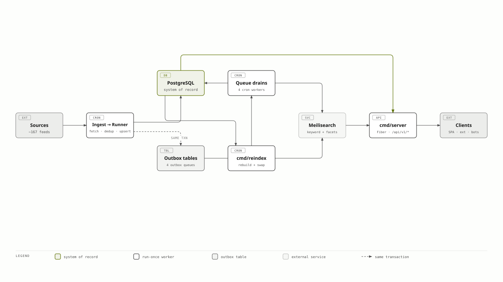
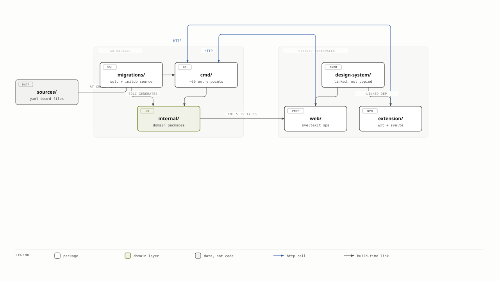
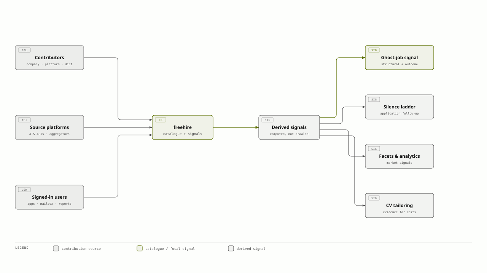

# freehire architecture

A map of how freehire fits together: where a job posting enters the system, what happens to it on the way to a search result, and what the surfaces built on top of that catalogue — the CV workspace, the application tracker, the in-app assistant — are actually made of.

This is the **map**. The territory is the per-package `AGENTS.md` files, which carry the invariants, the traps, and the reasoning behind specific decisions. Every section here ends with pointers into them. If you want to know *what freehire does* rather than how it is built, [`docs/features.md`](features.md) is the feature reference, and the endpoint documentation lives at [freehire.me/docs/api](https://freehire.me/docs/api) — neither is reproduced here.

You do not need to read Go to follow this document.

## Contents

- [The shape of the system](#the-shape-of-the-system)
- [The repository](#the-repository)
- [The ecosystem](#the-ecosystem)
- [Flows](#flows)
- [Auth model](#auth-model)
- [Notifications](#notifications)
- [Job lifecycle](#job-lifecycle)
- [Where to go deeper](#where-to-go-deeper)

## The shape of the system

freehire is a Go monolith with a satellite constellation of single-purpose workers. The HTTP server does one thing — serve the API, including the in-app assistant's request-time LLM calls — and every crawl, every background LLM call (enrichment, embeddings), every index rebuild happens in a **run-once-and-exit worker** that a cron schedule starts and that exits when its work is done. There is no job queue daemon and no long-lived background runtime; the only two processes that stay up are `cmd/server` and `cmd/mail-ingest`, the inbound-mail listener.

That choice shapes everything downstream. Because workers do not share memory with the server or with each other, all coordination happens in Postgres — which is why the write paths are full of **transactional outboxes**: a table row queued in the same transaction as the write that caused it, drained later by whichever worker owns that queue.

*Collapsed for readability: `Sources` folds the four crawl channels, `Queue drains` folds `cmd/enrich` · `cmd/search-drain` · `cmd/embed` · `cmd/capture-apply-form`, and `Clients` folds the SPA, extension, bots, and third-party API consumers. See each package's own `AGENTS.md` (linked below) for the full fan-out.*

**Ingest.** `cmd/ingest` takes one provider per run — `greenhouse`, `lever`, and so on — reading that provider's live boards from the `boards` catalog, so each provider crawls on its own schedule and a slow platform never blocks a fast one. Every board was validated against the adapter registry when it entered the catalog, before any request went out; the run hands off to `pipeline.Runner`, which fetches each board once, normalizes postings into a single schema, deduplicates, and upserts. The dedup key is `jobs.UNIQUE (source, external_id)`, so re-running a crawl is free. A board that keeps failing backs off on a recorded cooldown rather than being hammered every run. The large majority of postings are crawled straight from an employer's own ATS or career page; aggregators and Telegram are a smaller supplementary slice of the same pipeline — see [README's Sources breakdown](../README.md#sources) for the exact split.

**Storage.** Postgres is the system of record for everything: the catalogue, accounts, CVs, applications, mail, assistant transcripts. Database access is generated by [sqlc](https://sqlc.dev/) from hand-written SQL — there is no ORM, and `internal/platform/db/*.go` is generated code that is committed so the repo builds without sqlc installed. `migrations/` is the single source of truth for schema and feeds both sqlc's codegen and Postgres's first-boot initdb.

**Enrichment and indexing.** A crawl writes the posting and, in the same transaction, queues it: into `enrichment_outbox` if it is new, and into `search_outbox` if its content actually changed. That second condition matters — an unchanged re-crawl takes a cheap path that only refreshes a "last seen" timestamp, so the whole catalogue is not re-indexed every few hours. `cmd/enrich` drains the enrichment queue through an LLM behind a typed, validated contract; `cmd/search-drain` builds documents from the stored rows and pushes a whole claimed wave to Meilisearch as one task.

That batching is not a micro-optimisation. Meilisearch re-merges its inverted index across the *whole* live index on every push regardless of batch size — measured at 90–180 seconds per push on a ~2.7M-document index — so the earlier design, where ~169 independent per-board processes each pushed directly, saturated host disk IO. The outbox collapses many small pushes into few fat ones.

**Search.** The `jobs` Meilisearch index holds the public job shape, keyword/facet fields
and skill vectors (the match sort). Similar jobs query that index at request time by
keywords on the source's title, always within the source's known location and
specialization. Current visibility is checked in Postgres before returning recommendations.
`cmd/embed` keeps description vectors in `job_semantic_chunks`; they do not reach the
index, and there is no similarity backfill or precomputed list.

**The API.** One Fiber server, one public wire shape. `internal/job/jobview` owns the single JSON representation of a job used by the list endpoint, the detail endpoint, and the search index alike, so those surfaces cannot drift apart. Responses use `{"data": ...}` for single items, `{"data": ..., "meta": {...}}` for lists, and `{"error": msg}` for failures. The catalogue is public and keyless — `GET https://freehire.me/api/v1/jobs` needs no credential.

Deeper: [`internal/ingest/pipeline`](../internal/ingest/pipeline/AGENTS.md) · [`internal/ingest/sources`](../internal/ingest/sources/AGENTS.md) · [`internal/search`](../internal/search/AGENTS.md) · [`internal/search/searchdrain`](../internal/search/searchdrain/AGENTS.md) · [`internal/platform/db`](../internal/platform/db/AGENTS.md) · [`internal/api/handler`](../internal/api/handler/AGENTS.md) · [`internal/job/jobview`](../internal/job/jobview/AGENTS.md)

## The repository

*`docs/` and `openspec/` are omitted from the diagram — they carry no code-level edges of their own.*

**`cmd/`** holds roughly sixty entry points. Two are long-lived: `cmd/server` and `cmd/mail-ingest`. Everything else — crawlers, queue drains, backfills, rollups, notification passes — takes `DATABASE_URL`, does one pass, and exits non-zero on failure. What keeps a cron worker from stacking on itself is systemd's `Type=oneshot`, not a file lock.

**`internal/`** is where the domain lives, one package per concern — and each package sits in exactly one of eleven **blocks**, which form eight layers. Reading bottom-up: `platform` (db, worker plumbing, transport — nothing here knows what a vacancy is), `dict` (the facet dictionaries), `ai` and `identity`, `candidate`, `job`, `application` and `search`, `engage` and `ingest`, and `api` at the top. A block may import only blocks strictly below it, and two blocks sharing a layer may not see each other at all. `depguard` fails on the offending import line; [`internal/platform/arch/layering`](../internal/platform/arch/layering) holds the same table and reports the whole graph at once. Each block carries an `AGENTS.md` saying what it is and what it may reach for, and the substantial packages carry their own; the table at the end of [`AGENTS.md`](../AGENTS.md) indexes all of them. Two conventions are worth knowing before reading any of it: `internal/platform/db` is **generated** (edit `internal/platform/db/queries/*.sql` and run `make sqlc`), and handlers are thin — they parse, call a service, and render, so a rule added to a handler is a rule the assistant's tools never meet, since those tools call the same services directly.

**The `boards` catalog** is data, not code, and it is what most contributions add to: one row per (provider, board, region), carrying the company it belongs to. A row is added by the site's "contribute a board" form (at `pending`, proven by its first successful crawl) or by `cmd/add-board` (at `active`, since a curator has already verified it). Retiring a board flips its row to `status='retired'`, never deletes it — ingest crawls only live rows, so the retirement is a status and a mistake is undone by re-adding the board.

**`web/`** is the SvelteKit SPA, served same-origin with the API in production and proxied to it in development. It does not hand-maintain its view of the backend's types: `cmd/gen-contracts` generates `web/src/lib/generated/contracts.ts` from the Go wire structs and the closed vocabularies (source names, application stages, enrichment facets), so a value added in Go and missing from the SPA's maps is a TypeScript error rather than a blank cell that ships green.

**`design-system/`** is a sibling pnpm package linked into `web/` and `extension/` by symlink rather than copy — install it before building either consumer, because neither package manager installs a linked package's own dependencies for you.

Deeper: [`AGENTS.md`](../AGENTS.md) for the full module index · [`web/AGENTS.md`](../web/AGENTS.md) · [`design-system/AGENTS.md`](../design-system/AGENTS.md) · [`extension/AGENTS.md`](../extension/AGENTS.md) · [`CONTRIBUTING.md`](../CONTRIBUTING.md)

## The ecosystem

freehire is fed by three quite different kinds of contribution, and the system's shape reflects which of them is cheap and which is expensive.

*Each contributor category, and `Signed-in users`, folds several distinct sources — see the prose above for the full breakdown.*

**Contributors** mostly add coverage, and coverage is deliberately a one-line change. For a company on a platform freehire already crawls, adding it is one entry in that provider's board file — the single most useful contribution anyone can send. Only a company on an unsupported ATS needs a new adapter, and even then every adapter speaks the same `Source` interface, so the work is bounded. Dictionaries are the third path: skills, roles, locations and the non-technical-title terms are curated word lists, and they are **dict-only in production** — the system never guesses a facet, it emits nothing for an unknown.

**Source platforms** are read-only public JSON APIs, keyless by default, and adapters never write to them. A handful of exceptions need a vendor credential, and that credential gates only the *crawl* registry, never the *classification* registry — what kind of source a provider is must not depend on whether this particular host is able to crawl it.

**Users** contribute the only evidence the crawl cannot produce: what happened after somebody applied. That data feeds derived signals that no amount of scraping could support — most visibly the ghost-job signal, which combines *structural* evidence about a posting's shape with *outcome* evidence from people who applied, and which is deliberately built so that structural evidence alone can never produce its stronger claim. The system observes facts about a posting and never an employer's intent, and that constraint is enforced in code rather than in wording.

Deeper: [`internal/ingest/sources`](../internal/ingest/sources/AGENTS.md) · [`internal/job/ghost`](../internal/job/ghost/AGENTS.md) · [`internal/application/userjob`](../internal/application/userjob/AGENTS.md) · [`internal/dict/skilltag`](../internal/dict/skilltag/AGENTS.md) · [`internal/dict/classify`](../internal/dict/classify/AGENTS.md)

## Flows

Three flows — finding a job, tailoring a CV, asking the assistant — are traced end to end in [architecture/flows.md](architecture/flows.md).

## Auth model

Sessions are a stateless HS256 JWT carried in an `HttpOnly; SameSite=Lax` cookie — never a `Bearer` header, never `localStorage` — so the SPA cannot read the token and the browser attaches it automatically. Same-origin plus `SameSite=Lax` *is* the CSRF defence; there is no CSRF token. The token carries the user id and `tv`, the account's session generation, which is compared against `users.token_version` on every authenticated request: bumping it (sign-out-everywhere, a password change, a reset) strands every outstanding token, and the version load deliberately **fails closed**, which is also what terminates a deleted account's sessions everywhere.

API keys are the programmatic credential. They are hashed at rest (SHA-256 plus a short non-secret prefix so keys are distinguishable in a list), shown exactly once at creation, and scoped `full` or `cv`. Minting one requires a **proven** email address, and that gate lives inside the SQL statement rather than beside it — registration hands out a session before the address is verified, so a squatter on someone else's email could otherwise walk away with a never-expiring credential. Key management is cookie-only: a leaked key must not be able to mint further keys. A key does not carry `tv`, so a sign-out-everywhere does not revoke it — deliberate, since a key is a durable credential rather than a session — which is why a genuine takeover *deletes* the rows instead.

The **seizure rule** closes the remaining hole. An account registered with a password but never verified is seized — password cleared, sessions revoked, API keys deleted — the moment a provider-verified OAuth identity arrives for that address. OAuth resolution itself is identity-first, then verified-email link, then new passwordless user, all in one transaction, and never links or creates on an unverified email.

Deeper: [`internal/identity/auth`](../internal/identity/auth/AGENTS.md) · [`internal/identity/auth/oauth`](../internal/identity/auth/oauth/AGENTS.md) · [`internal/identity/accounts`](../internal/identity/accounts/AGENTS.md)

## Notifications

Three independent delivery engines share one channel vocabulary. `internal/engage/notify` sends digests of new jobs matching a saved search; `internal/engage/reminder` nudges a saved job before it goes stale; `internal/engage/nudge` fires on lifecycle events — an application that has gone silent past its stage's threshold, or one that just moved into `interview`. Each has its own run-once cron worker (`cmd/notify`, `cmd/remind`, `cmd/nudge`).

Three channels carry them: email over SES, Telegram via a bot deep-link token, and mobile push through an Expo relay. Push is registered unconditionally because Expo holds the device credential on its own side; the other two are configuration-gated, and an unconfigured channel is a **soft skip**, never a delivery failure — promoting it would fail every run in an environment without SES.

Two properties keep the volume sane. Matching is `O(distinct queries)`, not `O(subscribers)`: subscriptions sharing a saved search are grouped so the index is hit once no matter how many people subscribed. And delivery is idempotent through a two-stage ledger — MATCH records what matched, DELIVER leases and marks it sent — so re-scanning recent jobs never delivers twice. The lifecycle nudges add an "episode key" to that dedup: the fact that must change before re-notifying is warranted, which is what lets the matcher re-scan the same still-silent application every pass without re-pinging it.

Delivery is cron-driven with no retry queue, so a channel outage skips that pass's digests; the ledger redelivers only what was never marked sent.

Deeper: [`docs/agents/notifications.md`](agents/notifications.md) · [`docs/agents/mail-stack.md`](agents/mail-stack.md)

## Job lifecycle

A job is open while `closed_at IS NULL`. Closing is a **soft** state, and the lifecycle never deletes: a closed row keeps its public slug, its enrichment and its user references, and reopens for free if the posting comes back. List, search and company surfaces filter to open rows, while the detail endpoint still serves a closed job so links and history do not break.

Four independent mechanisms write that column, each covering a gap the others structurally cannot reach. The **ingest sweep** closes a provider's postings unseen for 48 hours, scoped to the companies a run actually crawled. **Stream-driven self-close** handles aggregators that publish an incremental change feed and emit an explicit removal, which is why those sources are excluded from the sweep — they re-report only what changed. The **liveness probe** URL-probes orphans that no crawl revisits, classifying the page with pure heuristics (no browser, no LLM) and closing only after two consecutive expired reads. And an **age rule** closes what cannot be probed at all — a Telegram post outlives the vacancy it advertises — at 45 days. Three of the four close on evidence; the fourth closes on a guess, which is exactly why every close records *which* mechanism wrote it in `closed_reason`, making a guess reversible as a set.

Nothing hard-deletes jobs. A former campaign, `cmd/prune`, removed postings that did not belong on an IT job board (archived in `pruned_jobs`); it was retired once the catalogue became broader than IT. Applications whose posting it removed survive with a NULL `job_id`.

Deeper: [`docs/agents/job-lifecycle.md`](agents/job-lifecycle.md) · [`internal/ingest/pipeline`](../internal/ingest/pipeline/AGENTS.md) · [`internal/platform/worker`](../internal/platform/worker/AGENTS.md)

## Where to go deeper

This document is a map; the files below are the territory. [`AGENTS.md`](../AGENTS.md) carries the full module index — thirty-plus packages with their own conventions — and is the right next stop for anything not listed here.

| If you are working on… | Read |
|---|---|
| Adding a company or an ATS platform | [`internal/ingest/sources`](../internal/ingest/sources/AGENTS.md), [`README`](../README.md#adding-a-source) |
| The crawl, dedup, or board health | [`internal/ingest/pipeline`](../internal/ingest/pipeline/AGENTS.md) |
| Search, indexing, or a reindex incident | [`internal/search`](../internal/search/AGENTS.md), [`internal/search/searchdrain`](../internal/search/searchdrain/AGENTS.md) |
| HTTP routes, error rendering, middleware | [`internal/api/handler`](../internal/api/handler/AGENTS.md) |
| SQL, migrations, or sqlc | [`internal/platform/db`](../internal/platform/db/AGENTS.md) |
| Sessions, keys, OAuth | [`internal/identity/auth`](../internal/identity/auth/AGENTS.md), [`internal/identity/auth/oauth`](../internal/identity/auth/oauth/AGENTS.md) |
| The CV workspace | [`internal/candidate/cv`](../internal/candidate/cv/AGENTS.md), [`internal/candidate/cvedit`](../internal/candidate/cvedit/AGENTS.md), [`internal/candidate/experience`](../internal/candidate/experience/AGENTS.md) |
| The assistant, its tools or presets | [`internal/ai/assistant`](../internal/ai/assistant/AGENTS.md) |
| Mail ingestion and application linking | [`docs/agents/mail-stack.md`](agents/mail-stack.md) |
| Digests, reminders, nudges | [`docs/agents/notifications.md`](agents/notifications.md) |
| Closing, pruning, liveness | [`docs/agents/job-lifecycle.md`](agents/job-lifecycle.md) |
| The SPA | [`web/AGENTS.md`](../web/AGENTS.md), [`design-system/AGENTS.md`](../design-system/AGENTS.md) |
| The browser extension | [`extension/AGENTS.md`](../extension/AGENTS.md) |
| What a feature does, rather than how | [`docs/features.md`](features.md) |
| Endpoints and parameters | [freehire.me/docs/api](https://freehire.me/docs/api) |

An older hand-drawn view of the ingest path is kept at [`docs/diagrams/job-pipeline.excalidraw`](diagrams/job-pipeline.excalidraw); the diagrams above supersede it.
